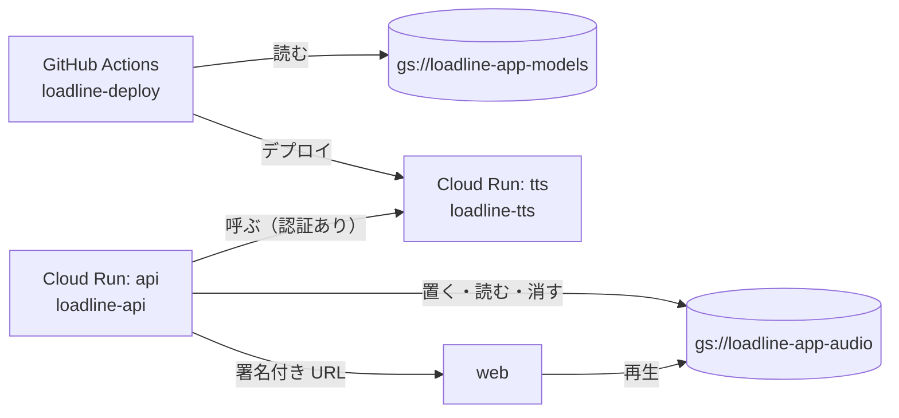

# 音声と tts の GCP の設定

振り返りを声にするために、GCP（プロジェクト `loadline-app`、リージョン `asia-northeast1`）に入れた設定です。
コンソールやコマンドで手で入れたもので、コードには残りません。作り直すときは、ここのコマンドを上から流します。

## 全体の形



## バケット

どちらも東京に置き、権限はバケット単位だけで管理し、公開を止めています。

| バケット | 置くもの | 古いものを消す設定 | 消したものを残す期間（soft delete） |
|---|---|---|---|
| `gs://loadline-app-audio` | 振り返りの音声 | なし | 0（残さない） |
| `gs://loadline-app-models` | Kokoro のモデル（`kokoro-v1.0/` の下に 2 つ、約 350MB） | なし | 7 日（新しいバケットの既定） |

音声に古いものを消す設定を付けないのは、デモの振り返りの音声まで消えるためです。音声は 1 件で約 1.4MB（30 秒の WAV）で、週に 1 件なので、量は気にしなくてよい大きさです。

音声は、消したらすぐに戻せなくします。アカウントを消したとき（`DELETE /me`）に本人の音声も消すので、7 日のあいだ復元できると、消したという約束とずれるためです。モデルは誤って消したときに戻せるよう、既定の 7 日のままにしています。

モデルを音声と別のバケットにしたのは、api が音声のバケットに持つ書き込みと削除の権限を、モデルに届かせないためです。モデルは配布元（kokoro-onnx の GitHub Releases の `model-files-v1.0`）が消えたときの控えも兼ねます。

```sh
gcloud storage buckets create gs://loadline-app-audio \
  --project loadline-app --location asia-northeast1 \
  --uniform-bucket-level-access --public-access-prevention \
  --soft-delete-duration 0

gcloud storage buckets create gs://loadline-app-models \
  --project loadline-app --location asia-northeast1 \
  --uniform-bucket-level-access --public-access-prevention

# ルートで。モデルは tts/README.md の手順で tts/ に取ってある前提
gcloud storage cp tts/kokoro-v1.0.onnx tts/voices-v1.0.bin \
  gs://loadline-app-models/kokoro-v1.0/ --project loadline-app
```

## サービスアカウント

| サービスアカウント | 使うところ |
|---|---|
| `loadline-api` | Cloud Run の api の実行用 |
| `loadline-tts` | Cloud Run の tts の実行用 |
| `loadline-deploy` | GitHub Actions のデプロイ用（Workload Identity Federation で入る） |

```sh
gcloud iam service-accounts create loadline-tts --project loadline-app
```

## 権限

プロジェクト全体には付けず、相手のバケットやサービスアカウントだけに付けています。

| 誰に | 何に | ロール | なぜ |
|---|---|---|---|
| `loadline-api` | `gs://loadline-app-audio` | `roles/storage.objectUser` | 音声を置く、読む（署名付き URL の再生も）、一覧を取る。アカウントを消すときに本人の音声を消す |
| `loadline-api` | `loadline-api` 自身 | `roles/iam.serviceAccountTokenCreator` | 署名付き URL を作る。Cloud Run には鍵のファイルがないので、IAM の signBlob で署名する |
| `loadline-deploy` | `gs://loadline-app-models` | `roles/storage.objectViewer` | tts のイメージを組み立てる前にモデルをコピーする |
| `loadline-deploy` | `loadline-tts` | `roles/iam.serviceAccountUser` | tts を `loadline-tts` として動かすデプロイに要る（actAs） |
| `loadline-api` | Cloud Run の `tts` | `roles/run.invoker` | 認証が必須の tts を呼ぶ。tts を初めて出したあとに付ける |

音声の権限は、オブジェクトの権限の設定まで含む `objectAdmin` ではなく、読み書きと削除だけの `objectUser` にしています。

```sh
gcloud storage buckets add-iam-policy-binding gs://loadline-app-audio \
  --project loadline-app \
  --member=serviceAccount:loadline-api@loadline-app.iam.gserviceaccount.com \
  --role=roles/storage.objectUser

gcloud iam service-accounts add-iam-policy-binding \
  loadline-api@loadline-app.iam.gserviceaccount.com \
  --project loadline-app \
  --member=serviceAccount:loadline-api@loadline-app.iam.gserviceaccount.com \
  --role=roles/iam.serviceAccountTokenCreator

gcloud storage buckets add-iam-policy-binding gs://loadline-app-models \
  --project loadline-app \
  --member=serviceAccount:loadline-deploy@loadline-app.iam.gserviceaccount.com \
  --role=roles/storage.objectViewer

gcloud iam service-accounts add-iam-policy-binding \
  loadline-tts@loadline-app.iam.gserviceaccount.com \
  --project loadline-app \
  --member=serviceAccount:loadline-deploy@loadline-app.iam.gserviceaccount.com \
  --role=roles/iam.serviceAccountUser

# tts を初めて出したあとに
gcloud run services add-iam-policy-binding tts \
  --project loadline-app --region asia-northeast1 \
  --member=serviceAccount:loadline-api@loadline-app.iam.gserviceaccount.com \
  --role=roles/run.invoker
```

`loadline-tts`（tts の実行用）には何も付けていません。tts はモデルをイメージに含めていて、外の何も呼ばないためです。

## tts の Cloud Run

`.github/workflows/deploy-tts.yml` が、main に入った `tts/` の変更を出します。値は試作で測ったものです。

| 設定 | 値 | なぜ |
|---|---|---|
| CPU、メモリ | 4 vCPU、2GiB | 1 回の読み上げが約 10 秒。メモリは最大で約 1.1GB 使い、1GiB では足りない |
| 認証 | 必須 | api からしか呼ばない |
| 1 台で同時に受ける数 | 1 | 1 回の読み上げで CPU を使い切る |
| 台数の上限（`--max`） | サービス全体で 2 | 費用を抑える。`--max-instances` はリビジョンごとの上限で、複数のリビジョンにトラフィックを分けると合計で 2 台を超えうるため、使わない |
| 1 回のリクエストの上限（`--timeout`） | 60 秒 | 0 台からの起動と、最初の `/speak` でのモデルの読み込みを含めても収まる長さ。既定の 300 秒では、止まったときに気づくのが遅い |
| 起動中の CPU の追加（`--cpu-boost`） | あり | 0 台から起き上がる時間を縮める。試作では、0 台からの最初の応答に約 21 秒かかった |

台数の下限は 0 なので、使っていないあいだは費用がかかりません。

上限が 2 台なので、同時に 3 件来ると 3 件目は 429 になります（自動の振り返りが同じ時刻に重なったときなど）。api の側で、429 は間を空けてやり直します。

### デプロイが重ならないように

`deploy-tts.yml` と `deploy.yml` は、同じ workflow を並べて走らせません（`concurrency`）。`queue: max` にして、来た順に 1 つずつ走らせ、待っている実行は取り消しません。既定の `queue: single` では待ちに並ぶのが 1 つだけで、古い実行を Re-run すると、待っていた最新の実行が取り消されてしまうためです。

そのうえで、デプロイの直前に、出そうとしている版と今の main の中身を比べます（tts なら `tts/` と `deploy-tts.yml`、api なら `api/`、`web/`、`Dockerfile`、`.dockerignore`、`deploy.yml`）。違えば、もっと新しい変更があるので出しません。古い実行を Re-run したときに、古い版を出し直さないためです。main の先頭のコミットそのものと比べないのは、ほかの場所だけを変えたコミットが後に入ったときに、出すべき版まで止めてしまうためです。api はマイグレーションより前で止めます。
