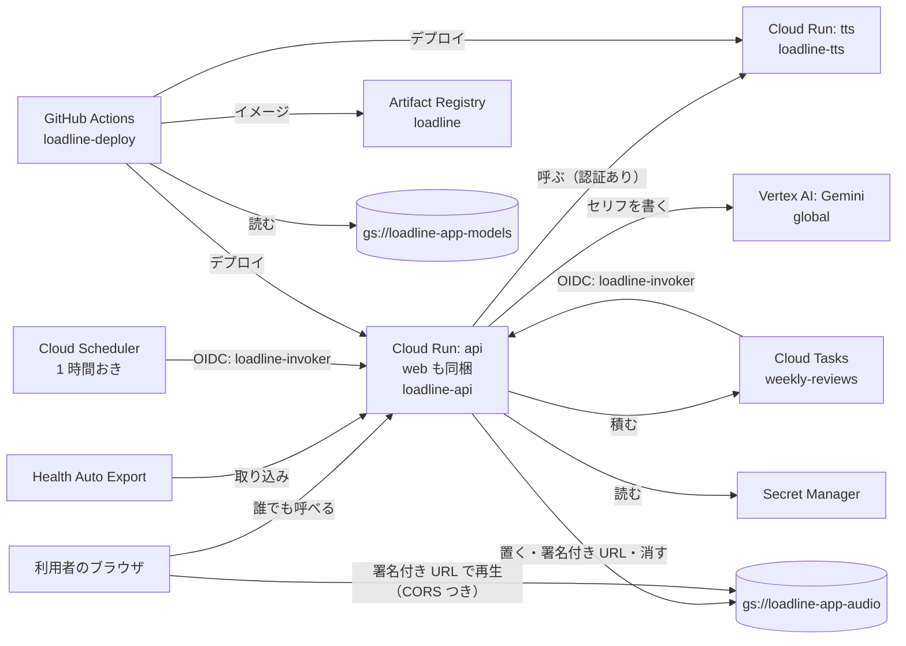

# GCP の設定

loadline が GCP（プロジェクト `loadline-app`）に持っている設定の一覧です。2026-11-08 に、実際の GCP を読み取って書きました。音声のバケットの CORS は、2026-11-11 に入れて書き足しました。

- リージョンは `asia-northeast1`（東京）にそろえています。例外は Gemini（Vertex AI）で、api は `global` のエンドポイントを呼びます（api の設定 `gemini_location` の既定。`deploy.yml` は `GEMINI_LOCATION` を渡していない）
- Cloud Run へのデプロイ（`.github/workflows/deploy.yml`、`deploy-tts.yml`）が入れる設定以外は、コンソールやコマンドで手で入れたもので、コードには残りません。変えたら、この文書も直します
- 週次レビューの音声は、api が tts で声にして音声のバケットに置き、署名付き URL を返します。web はその URL を、ブラウザから直接読んで再生します。CORS つきで読み、声の大きさでアバターの口を動かします
- データベースは GCP ではなく Neon（AWS シンガポール）です。接続の URL だけを Secret Manager に置いています
- 今の設定を確かめるコマンドは、最後の「確かめ方」にあります

## 全体の形



## サービスアカウント

既定の Compute サービスアカウント（`969839428626-compute@developer.gserviceaccount.com`）は使わず、権限も付けていません（既定で付く `roles/editor` も外しています）。用途ごとに分け、権限は相手のリソースだけに付けます。

| サービスアカウント | 使うところ |
|---|---|
| `loadline-api` | Cloud Run の api と、マイグレーションの Job の実行用 |
| `loadline-tts` | Cloud Run の tts の実行用 |
| `loadline-invoker` | Cloud Scheduler と Cloud Tasks が api の内部の窓口を呼ぶときの身元 |
| `loadline-deploy` | GitHub Actions のデプロイ用（Workload Identity Federation で入る） |
| `firebase-adminsdk-fbsvc` | Firebase が作ったもの。loadline からは使っていない |

```sh
gcloud iam service-accounts create loadline-api --project loadline-app
gcloud iam service-accounts create loadline-tts --project loadline-app
gcloud iam service-accounts create loadline-invoker --project loadline-app
gcloud iam service-accounts create loadline-deploy --project loadline-app
```

## 権限

サービスエージェント（Google が自動で付けるもの）は省いています。

### プロジェクト全体

| 誰に | ロール | なぜ |
|---|---|---|
| 持ち主の Google アカウント | `roles/owner` | 持ち主 |
| `loadline-api` | `roles/aiplatform.user` | Gemini（Vertex AI）を呼ぶ |
| `loadline-api` | `roles/firebaseauth.admin` | アカウントの削除（`DELETE /me`）で Firebase の利用者を消す |
| `loadline-deploy` | `roles/run.admin` | Cloud Run のサービスと Job をデプロイする |

### リソースごと

| 誰に | 何に | ロール | なぜ |
|---|---|---|---|
| `allUsers` | Cloud Run の `api` | `roles/run.invoker` | 画面と取り込みの窓口。認証は api の中で Firebase のトークンと取り込みのトークンで行う |
| `loadline-api` | Cloud Run の `tts` | `roles/run.invoker` | 認証が必須の tts を呼ぶ |
| `loadline-api` | Secret Manager の `database-url`、`typesafe-api-key` | `roles/secretmanager.secretAccessor` | DB の URL と Jev のキーを読む |
| `loadline-api` | Cloud Tasks の `weekly-reviews` | `roles/cloudtasks.enqueuer` | 週次レビューを作る相手を 1 人ずつ積む |
| `loadline-api` | `loadline-invoker` | `roles/iam.serviceAccountUser` | 積むタスクに `loadline-invoker` の OIDC トークンを付ける（actAs） |
| `loadline-api` | `loadline-api` 自身 | `roles/iam.serviceAccountTokenCreator` | 署名付き URL を作る。Cloud Run には鍵のファイルがないので、IAM の signBlob で署名する |
| `loadline-api` | `gs://loadline-app-audio` | `roles/storage.objectUser` | 音声を置く、一覧を取る、消す。再生は署名付き URL なので、利用者は権限なしで読める |
| `loadline-deploy` | `loadline-api`、`loadline-tts` | `roles/iam.serviceAccountUser` | それぞれを実行用に指定してデプロイする（actAs） |
| `loadline-deploy` | Artifact Registry の `loadline` | `roles/artifactregistry.writer` | イメージを push する |
| `loadline-deploy` | `gs://loadline-app-models` | `roles/storage.objectViewer` | tts のイメージを組み立てる前にモデルをコピーする |
| GitHub の `d-station-grid/loadline`（Workload Identity のプール経由） | `loadline-deploy` | `roles/iam.workloadIdentityUser` | Actions が鍵なしで `loadline-deploy` になる |

`loadline-tts` と `loadline-invoker` には、何も付けていません。tts はモデルをイメージに含めていて、外の何も呼ばないためです。`loadline-invoker` は呼ぶときの名札で、api は内部の窓口で呼び出し元のメールがこれかを確かめます。

音声の権限は、オブジェクトの権限の設定まで含む `objectAdmin` ではなく、読み書きと削除だけの `objectUser` にしています。

```sh
# tts と音声（ほかの権限も、同じ形のコマンドで付けている）
gcloud run services add-iam-policy-binding tts \
  --project loadline-app --region asia-northeast1 \
  --member=serviceAccount:loadline-api@loadline-app.iam.gserviceaccount.com \
  --role=roles/run.invoker

gcloud iam service-accounts add-iam-policy-binding \
  loadline-api@loadline-app.iam.gserviceaccount.com \
  --project loadline-app \
  --member=serviceAccount:loadline-api@loadline-app.iam.gserviceaccount.com \
  --role=roles/iam.serviceAccountTokenCreator

gcloud storage buckets add-iam-policy-binding gs://loadline-app-audio \
  --project loadline-app \
  --member=serviceAccount:loadline-api@loadline-app.iam.gserviceaccount.com \
  --role=roles/storage.objectUser

gcloud storage buckets add-iam-policy-binding gs://loadline-app-models \
  --project loadline-app \
  --member=serviceAccount:loadline-deploy@loadline-app.iam.gserviceaccount.com \
  --role=roles/storage.objectViewer

gcloud iam service-accounts add-iam-policy-binding \
  loadline-tts@loadline-app.iam.gserviceaccount.com \
  --project loadline-app \
  --member=serviceAccount:loadline-deploy@loadline-app.iam.gserviceaccount.com \
  --role=roles/iam.serviceAccountUser
```

## Cloud Run

どちらも、台数の下限は 0 です。使っていないあいだは費用がかかりません。

### api（web を同梱）

`deploy.yml` が出します。URL は `https://api-qbvpsx77dq-an.a.run.app` です。

| 設定 | 値 |
|---|---|
| CPU、メモリ | 1 vCPU、512MiB |
| 1 台で同時に受ける数 | 80（既定） |
| 台数の上限 | 5（手で入れた値） |
| 1 回のリクエストの上限 | 300 秒（既定） |
| 起動中の CPU の追加 | あり（手で入れた値） |
| 呼べる人 | 誰でも |
| 環境変数 | `APP_ENV`、`FIREBASE_PROJECT_ID`、`INTERNAL_AUDIENCE`（api の URL）、`INTERNAL_CALLER_EMAIL`（`loadline-invoker`）、`TASKS_QUEUE`、`GEMINI_PROJECT`、`TTS_URL`（tts の URL）、`AUDIO_BUCKET`（`loadline-app-audio`） |
| Secret Manager から | `DATABASE_URL`（`database-url`）、`TYPESAFE_API_KEY`（`typesafe-api-key`） |

台数の上限 5 と起動中の CPU の追加は、`deploy.yml` には書いていません。手で入れた値で、`gcloud run deploy` が指定しなかった設定を前の版から引き継ぐので残っています。

マイグレーションは、同じイメージを Cloud Run の Job `api-migrate` として、デプロイの前に動かします。

### tts

`deploy-tts.yml` が出します。URL は `https://tts-qbvpsx77dq-an.a.run.app` です。値は試作で測ったものです。

| 設定 | 値 | なぜ |
|---|---|---|
| CPU、メモリ | 4 vCPU、2GiB | 1 回の読み上げが約 10 秒。メモリは最大で約 1.1GB 使い、1GiB では足りない |
| 呼べる人 | `loadline-api` だけ | api からしか呼ばない |
| 1 台で同時に受ける数 | 1 | 1 回の読み上げで CPU を使い切る |
| 台数の上限（`--max`） | サービス全体で 2 | 費用を抑える。`--max-instances` はリビジョンごとの上限で、複数のリビジョンにトラフィックを分けると合計で 2 台を超えうるため、使わない |
| 1 回のリクエストの上限（`--timeout`） | 60 秒 | 0 台からの起動と、最初の `/speak` でのモデルの読み込みを含めても収まる長さ。既定の 300 秒では、止まったときに気づくのが遅い |
| 起動中の CPU の追加（`--cpu-boost`） | あり | 0 台から起き上がる時間を縮める。試作では、0 台からの最初の応答に約 21 秒かかった |

上限が 2 台なので、同時に 3 件来ると、3 件目は空きが出るのを待ちます。待つあいだに前の読み上げが終われば処理され、空きが出なければ 429 になります。週次レビューの自動作成では、Cloud Tasks が同時に 2 件までしか送らないので、重なるのは画面から作った分が加わったときです。

api は 429（と 5xx、通信の失敗）のとき、10 秒、20 秒と間を空けてやり直します。最後の試行は約 30 秒後で、0 台からの起動（約 21 秒）を待ち切ります。試すのは最初の 1 回を含めて 3 回まで、全体で 45 秒までです（`api/app/adapters/tts.py`、api の設定 `tts_timeout_sec`）。それでも読めなければ、音声なしで週次レビューを作り、画面は文字だけで見せます。音声なしになった週は、あとから読み直しません。

### デプロイが重ならないように

`deploy-tts.yml` と `deploy.yml` は、同じ workflow を並べて走らせません（`concurrency`）。`queue: max` にして、来た順に 1 つずつ走らせ、待っている実行は取り消しません。既定の `queue: single` では待ちに並ぶのが 1 つだけで、古い実行を Re-run すると、待っていた最新の実行が取り消されてしまうためです。

そのうえで、デプロイの直前に、出そうとしている版と今の main の中身を比べます（tts なら `tts/` と `deploy-tts.yml`、api なら `api/`、`web/`、`Dockerfile`、`.dockerignore`、`deploy.yml`）。違えば、もっと新しい変更があるので出しません。古い実行を Re-run したときに、古い版を出し直さないためです。main の先頭のコミットそのものと比べないのは、ほかの場所だけを変えたコミットが後に入ったときに、出すべき版まで止めてしまうためです。api はマイグレーションより前で止めます。

## 週次レビューの自動作成（Cloud Scheduler と Cloud Tasks）

Scheduler が 1 時間おきに api を呼び、api が週次レビューを作る相手と週を探して、1 人ずつ Tasks に積みます。Tasks が 1 人ずつ api を呼び、セリフを作って声にします。どちらも `loadline-invoker` の OIDC トークンを付け、宛先（audience）は api の URL です。

| 設定 | 値 |
|---|---|
| Scheduler のジョブ | `weekly-review-dispatch`、毎時 0 分（UTC）、`POST /internal/reviews/dispatch` |
| Scheduler が積み込み（dispatch）を待つ時間 | 180 秒 |
| Tasks のキュー | `weekly-reviews` |
| Tasks が 1 人分の生成を待つ時間 | 180 秒（api が積むときにタスクごとに指定する。`api/app/adapters/cloud_tasks.py` の `DISPATCH_DEADLINE_SEC`）。Gemini 60 秒、Jev 15 秒を 2 回、読み上げ 45 秒、音声の保存 20 秒の上限で 155 秒。それにゆとりを足した長さ |
| 同時に送る数 | 2 |
| 試す回数 | 最初の 1 回を含めて 3 回まで（やり直しは 2 回まで）。間は 60 秒から 600 秒まで広げる |

## Secret Manager

どちらも東京にだけ複製を置いています。値は GitHub にも手元にも置きません。

| 秘密 | 中身 | 版 |
|---|---|---|
| `database-url` | Neon の接続の URL（asyncpg の形） | 2 が有効で、Cloud Run は `latest` を読む。1（asyncpg が読めない最初の形）は無効 |
| `typesafe-api-key` | TypeSafe AI（Jev）のキー | 1 |

## Artifact Registry

| リポジトリ | 中身 | 掃除 |
|---|---|---|
| `loadline`（東京、Docker） | `api` と `tts` のイメージ | 7 日より古いものを消す。ただし直近 10 個（`api` と `tts` それぞれ）は残す |

「残す」の決まりは「消す」より優先されます。掃除は 1 日に 1 回ほど裏で動きます。

ただし、残るのは各イメージの新しい 10 個で、動いている版とは限りません。workflow は、main と比べる手順やマイグレーションより前にイメージを push するので、出さずに終わった実行や失敗した実行のイメージも 10 個に数えられます。そうした実行が続くと、動いている版が 10 個から外れ、7 日より古ければ消えます。直し方は #71 に書いてあります。

`set-cleanup-policies` は、決まりを足すのではなく、ファイルの中身で全部を置き換えます。変えるときは、残す決まりも同じファイルに入れます。

```sh
cat > /tmp/loadline-ar-cleanup.json <<'JSON'
[
  {
    "name": "delete-older-than-7d",
    "action": {"type": "Delete"},
    "condition": {"tagState": "any", "olderThan": "7d"}
  },
  {
    "name": "keep-recent-10",
    "action": {"type": "Keep"},
    "mostRecentVersions": {"keepCount": 10}
  }
]
JSON

gcloud artifacts repositories set-cleanup-policies loadline \
  --project loadline-app --location asia-northeast1 \
  --policy=/tmp/loadline-ar-cleanup.json
```

## GitHub Actions からの入り方（Workload Identity Federation）

サービスアカウントの鍵は GitHub に置きません。

| 項目 | 値 |
|---|---|
| プール | `github` |
| プロバイダ | `github-oidc`（発行元 `https://token.actions.githubusercontent.com`） |
| 入れる条件 | リポジトリが `d-station-grid/loadline`、かつブランチが `refs/heads/main` |
| なれるサービスアカウント | `loadline-deploy` |
| GitHub の variables | `GCP_PROJECT_ID`、`GCP_WIF_PROVIDER`、`GCP_DEPLOY_SA`（秘密ではないので variables） |

## Cloud Storage

どちらも東京に置き、権限はバケット単位だけで管理し、公開を止めています。

| バケット | 置くもの | 古いものを消す設定 | 消したものを残す期間（soft delete） |
|---|---|---|---|
| `gs://loadline-app-audio` | 週次レビューの音声 | なし | 0（残さない） |
| `gs://loadline-app-models` | Kokoro のモデル（`kokoro-v1.0/` の下に 2 つ、約 350MB） | なし | 7 日（新しいバケットの既定） |

音声に古いものを消す設定を付けないのは、デモの週次レビューの音声まで消えるためです。音声は 1 件で約 1.4MB（30 秒の WAV）で、週に 1 件なので、量は気にしなくてよい大きさです。

音声は、消したらすぐに戻せなくします。アカウントを消したとき（`DELETE /me`）は、本人の音声（`users/{利用者の id}/` の下）も消します。そのとき 7 日のあいだ復元できると、消したという約束とずれるためです。

音声は `users/{利用者の id}/reviews/{週次レビューの id}.wav` に置きます。web には、期限 1 時間の署名付き URL を渡します（api の設定 `audio_url_ttl_sec`）。

api から Cloud Storage と IAM への通信には、上限を付けています（`api/app/adapters/audio_storage.py`）。置く・一覧・消すは 1 回 10 秒、やり直しを含めて 20 秒、署名は 5 秒です。SDK の既定（1 回 60 秒、やり直しを含めて 120 秒）のままだと、週次レビューを作る処理が Tasks の期限を超え、DB の行も長く持つためです。署名が間に合わなければ `audio_url` を null にして文字だけで返し、次に読むときにもう一度署名します。モデルは誤って消したときに戻せるよう、既定の 7 日のままにしています。

音声のバケットには CORS を設定しています（2026-11-11）。web は声の大きさを読み取ってアバターの口を動かすので（Web Audio）、音声を CORS つきで読むためです。

| 項目 | 値 |
|---|---|
| 許すオリジン | `https://api-qbvpsx77dq-an.a.run.app`（本番の画面）だけ |
| 許すメソッド | `GET`、`HEAD` |
| 返すヘッダー | `Content-Type`、`Content-Length`、`Content-Range`、`Accept-Ranges` |
| 事前確認を覚える時間 | 3600 秒 |

手元（localhost）は声を作らない設定なので、オリジンに入れていません。設定がないと、画面は音声を読めず、再生のボタンが消えます。独自のドメインを使うなど、画面のオリジンが変わったら、ここにも足します。`cors-file` は今の設定を丸ごと置き換えるので、足すときも全部のオリジンを書きます。

```sh
# どこでも。設定を書いたファイルを作って当てる
cat > /tmp/audio-cors.json <<'JSON'
[
  {
    "origin": ["https://api-qbvpsx77dq-an.a.run.app"],
    "method": ["GET", "HEAD"],
    "responseHeader": ["Content-Type", "Content-Length", "Content-Range", "Accept-Ranges"],
    "maxAgeSeconds": 3600
  }
]
JSON
gcloud storage buckets update gs://loadline-app-audio \
  --cors-file=/tmp/audio-cors.json --project loadline-app
```

モデルを音声と別のバケットにしたのは、api が音声のバケットに持つ書き込みと削除の権限を、モデルに届かせないためです。モデルは配布元（kokoro-onnx の GitHub Releases の `model-files-v1.0`）が消えたときの控えも兼ねます。

```sh
gcloud storage buckets create gs://loadline-app-audio \
  --project loadline-app --location asia-northeast1 \
  --uniform-bucket-level-access --public-access-prevention \
  --soft-delete-duration 0

gcloud storage buckets create gs://loadline-app-models \
  --project loadline-app --location asia-northeast1 \
  --uniform-bucket-level-access --public-access-prevention

# ルートで。モデルは tts/README.md の手順で tts/ に取ってある前提
gcloud storage cp tts/kokoro-v1.0.onnx tts/voices-v1.0.bin \
  gs://loadline-app-models/kokoro-v1.0/ --project loadline-app
```

## 請求と予算

請求先は CardiLife と共通です。

「利用額上限」は、上限に達すると、そのプロジェクトのそのサービスの新しい利用を止めます。処理中のリクエストは最後まで処理され、リソースやデータは消えません。止まるまでには少し遅れがあるので、上限を少し超えることがあります。

止まったサービスは、翌月の予算期間の初め（1 日）に自動で戻ります（既定。loadline の 2 つも既定のまま）。同じ月のうちに戻すには、上限を手で解除します。解除してから戻るまで、最大 1 時間ほどかかります。

| 予算 | 対象 | 月額 | 種類 |
|---|---|---|---|
| loadline 月次 | `loadline-app` 全体 | 1,000 円 | 通知だけ（50%、90%、100%） |
| loadline 上限 Cloud Run | `loadline-app` の Cloud Run | 2,000 円 | 利用額上限（自動で止まる） |
| loadline 上限 Vertex AI | `loadline-app` の Vertex AI | 1,000 円 | 利用額上限（自動で止まる） |

Cloud Storage、Artifact Registry、Neon は、利用額上限では止まりません。

## 有効な API

loadline が使っているのは次のものです。

`run`、`artifactregistry`、`iam`、`iamcredentials`、`sts`、`secretmanager`、`aiplatform`、`cloudtasks`、`cloudscheduler`、`storage`、`firebase`、`identitytoolkit`、`securetoken`、`billingbudgets`、`logging`、`monitoring`

ほかに、有効だが今は使っていないものがあります。

- `cloudbuild`: spike で試したソースからのデプロイで使った。今のデプロイは GitHub Actions で組み立てるので呼ばれない
- プロジェクトや Firebase を作ったときに既定で有効になったもの（BigQuery、Datastore、App Engine、Firebase Hosting など）

## 確かめ方

この文書と実際の GCP がずれていないかは、次のコマンドで見られます。どれも読み取りだけです。

```sh
# 権限（プロジェクト全体）とサービスアカウント
gcloud projects get-iam-policy loadline-app --project loadline-app
gcloud iam service-accounts list --project loadline-app
gcloud iam service-accounts get-iam-policy loadline-api@loadline-app.iam.gserviceaccount.com --project loadline-app

# Cloud Run
gcloud run services describe api --project loadline-app --region asia-northeast1
gcloud run services describe tts --project loadline-app --region asia-northeast1
gcloud run services get-iam-policy tts --project loadline-app --region asia-northeast1

# Scheduler と Tasks
gcloud scheduler jobs list --project loadline-app --location asia-northeast1
gcloud tasks queues describe weekly-reviews --project loadline-app --location asia-northeast1
gcloud tasks queues get-iam-policy weekly-reviews --project loadline-app --location asia-northeast1

# Secret Manager、Artifact Registry、Cloud Storage
gcloud secrets list --project loadline-app
gcloud artifacts repositories list --project loadline-app
gcloud storage buckets list --project loadline-app
gcloud storage buckets get-iam-policy gs://loadline-app-audio --project loadline-app
gcloud storage buckets describe gs://loadline-app-audio --project loadline-app --format='json(cors_config)'

# Workload Identity Federation
gcloud iam workload-identity-pools providers describe github-oidc \
  --project loadline-app --location global --workload-identity-pool github

# 予算
# 請求先アカウントの ID は `gcloud billing projects describe loadline-app --project loadline-app` で分かる
gcloud billing budgets list --billing-account <請求先アカウントの ID> --project loadline-app
```
