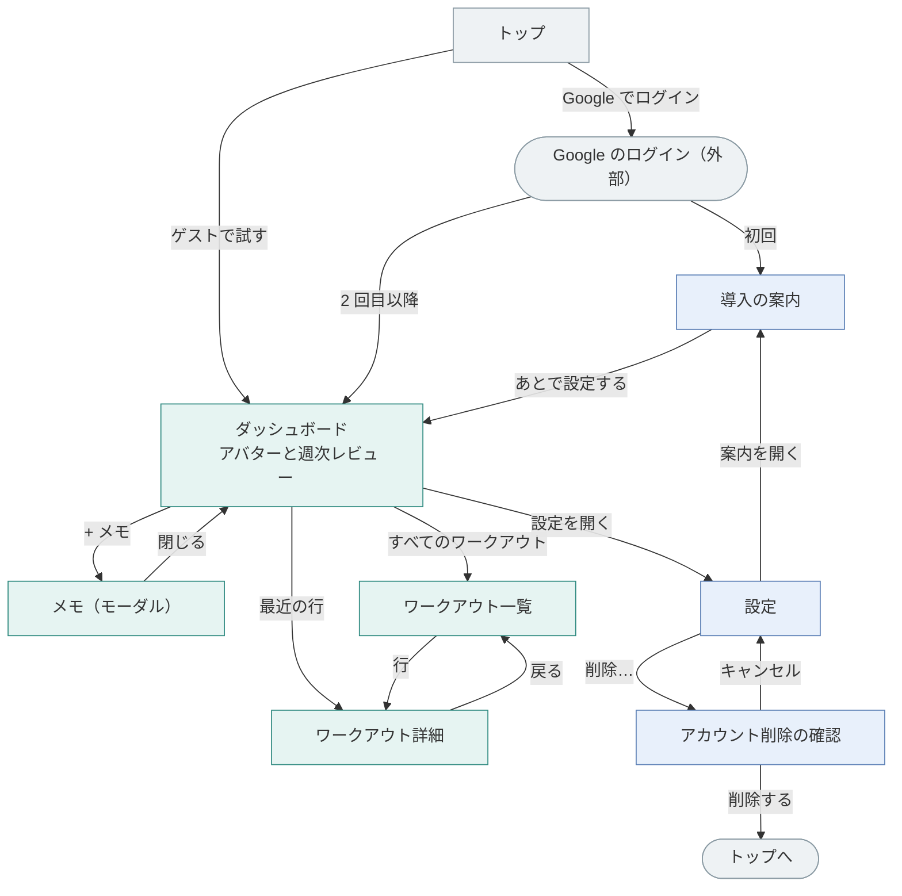

# 画面遷移図

矢印の横の文字は、押すボタンや、画面が切り替わる条件です。

色は、灰がログイン前、青が設定、緑が閲覧の画面です。

## 矢印の補足

- **初回**: Google でログインしたとき、記録がまだ一度も届いていなければ、導入の案内を出します。届いていれば、ダッシュボードを出します
- **ゲストで試す**: デモデータのダッシュボードに入ります
- **あとで設定する**: 最初の記録が届いたあとは、「ダッシュボードへ」でも移れます
- **+ メモ**: チャートの日付を押しても開きます
- **最近の行**: ダッシュボードの「最近のワークアウト」の行です
- **設定を開く**: 心拍がまだ入っていないとき、ダッシュボードに出ます。ふだんはヘッダーの「設定」から開きます
- **案内を開く**: 設定の画面の「設定の案内を開く」です
- **削除する**: アカウントとデータを消し、ログアウトしてトップに戻ります

## ヘッダー

ログインのあとは、どの画面にもヘッダーがあります。ヘッダーの「ダッシュボード」「ワークアウト」「設定」で、それぞれの画面に移れます。「ログアウト」を押すと、トップに戻ります。図では、ヘッダーからの矢印を省いています。

## ゲストにできないこと

ゲストは、デモデータを見るだけです。

| 画面 | ゲストのとき |
|---|---|
| 導入の案内 | 開けない |
| 設定 | 見られるが、変更はできない |
| アカウント削除の確認 | 開けない |
| ダッシュボード | 週次レビューの作成と、選択肢を選ぶことはできない |
| メモ | 読めるが、書けない |
