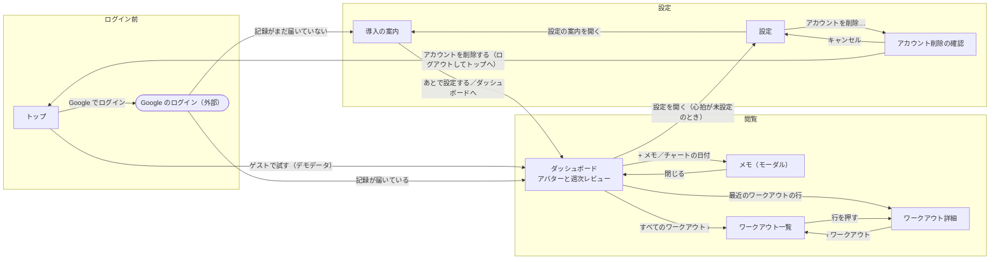

# 画面遷移図

矢印の横の文字は、押すボタンや、画面が切り替わる条件です。

## ヘッダー

ログインのあとは、どの画面にもヘッダーがあります。ヘッダーの「ダッシュボード」「ワークアウト」「設定」で、それぞれの画面に移れます。「ログアウト」を押すと、トップに戻ります。図では、ヘッダーからの矢印を省いています。

## ゲストにできないこと

ゲストは、デモデータを見るだけです。

| 画面 | ゲストのとき |
|---|---|
| 導入の案内 | 開けない |
| 設定 | 見られるが、変更はできない |
| アカウント削除の確認 | 開けない |
| ダッシュボード | 週次レビューの作成と、選択肢を選ぶことはできない |
| メモ | 読めるが、書けない |
